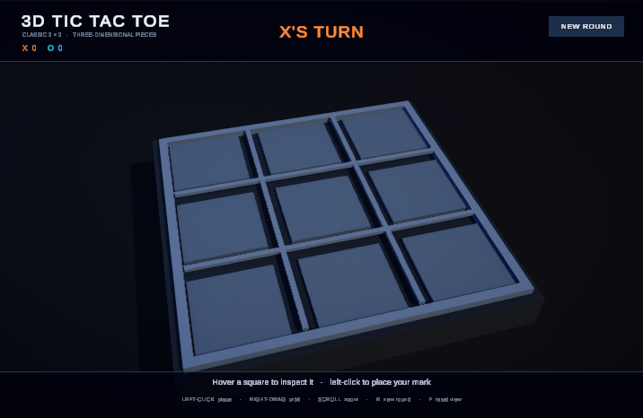
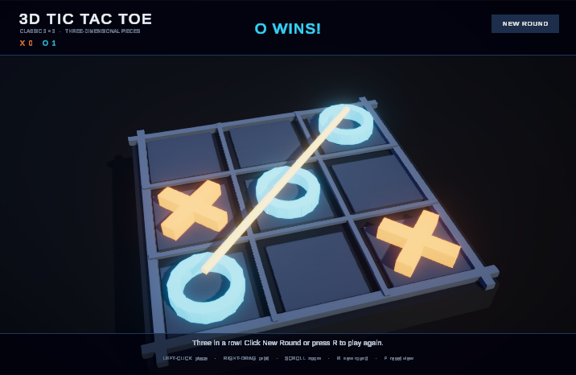

# 3D Tic-Tac-Toe

A complete local two-player tic-tac-toe game built with **Unity 6 (URP)** for the
final-year project demo. It's a **normal 3 × 3 board** — eight winning lines —
with **3D X and O pieces** rendered entirely from Unity primitives.

Everything is generated with Unity primitives and URP materials — there are no
external art, audio, or font assets to download.





---

## Running the game

1. Open the project in **Unity 6000.6.7f1** (Unity 6).
2. Open `Assets/TIC_TAC_TOE.unity`.
3. Press **Play**.

The scene is already first in Build Settings, so **File > Build And Run** also
works. Use a 16:9 Game view for the intended framing; the HUD also fits 4:3.

## Controls

| Input | Action |
| --- | --- |
| Move mouse over a tile | Inspect the cell; the tile glows |
| **Left-click** a tile | Place the current player's mark |
| **Right-drag** | Orbit the camera around the board |
| **Scroll wheel** | Zoom in / out |
| **F** | Reset the camera |
| **R** or **New Round** button | Start a new round |
| Hover the **New Round** button | Button highlight (clicks over the HUD never place a mark) |

## Rules

* Players take turns. **X** is amber, **O** is cyan.
* A move is legal only on an empty cell.
* The first player to line up **three marks along any straight line** wins:
  * three rows
  * three columns
  * two diagonals
* After a win the board locks, the winning line glows gold, and the score updates.
* **New Round** clears the board but keeps the score. The starting player
  alternates every round (X starts round 1, O starts round 2, and so on).
* If the board fills with no winner, it's a **draw**.

## Project structure

```
Assets/
  TIC_TAC_TOE.unity        Main scene: camera, lights, volume, HUD, GameController, Board
  Scripts/
    GameRules.cs           Pure 3 x 3 rules: 8 winning lines, win/full checks
    GameController.cs      Turn flow, mouse input, win/score handling, HUD text
    BoardView.cs           Builds the board at runtime and animates marks/win line
    BoardCell.cs           Clickable cell: coordinate, hover tint, mark reference
    OrbitCamera.cs         Right-drag orbit, scroll zoom, F reset
  Materials/               Six URP Lit materials (board, frame, floor, X, O, win line)
  Settings/                URP volume profile + project render settings
  TextMesh Pro/            TMP essentials (fonts and shaders)
Screenshots/               Captures used in this README
```

### How a click becomes a move

1. `GameController.Update()` casts a ray from the camera through the mouse
   position (`viewCamera.ScreenPointToRay`).
2. The ray hits a cell's `BoxCollider`. `BoardCell` gives the grid coordinate.
3. If the cell is empty, `TryPlace(coord)` asks `GameRules` to place the mark.
4. `BoardView.ShowMark()` spawns the 3D X (two crossed bars) or 3D O (ring of
   blocks) with a small pop-in animation.
5. `GameRules.CheckWinner()` checks the 8 winning lines. If a line is found,
   `BoardView.HighlightWin()` draws a glowing gold cylinder through the three
   cells and `GameController` locks input and updates the score.

Input uses the **new Input System package** (`Mouse.current`, `Keyboard.current`)
because the project is configured for the new input backend only.

## Viva / explanation notes

**Why split the code into four scripts?**
Each script has one job: rules (`GameRules`), presentation (`BoardView`,
`BoardCell`), flow/input (`GameController`), and camera (`OrbitCamera`). The rules
class is pure C# and does not reference Unity visuals, so it can be tested or
reused independently.

**Why generate the board at runtime?**
Nine tiles plus base, rim and grid lines would be tedious to place by hand.
`BoardView.Awake()` builds everything procedurally. Changing board size or
spacing is a one-line change.

**How is the win checked efficiently?**
Only 8 winning lines are hard-coded: three rows, three columns, two diagonals.
The check iterates these lines and compares the three cells. The first match
returns the winning player and the three cells, which are then used for the gold
highlight.

**Why do the scores persist but the board clears?**
The score belongs to the match, while the board belongs to a round. `NewRound()`
resets `GameRules` and the visuals but leaves `xScore` / `oScore` intact.

**How does alternating the starter keep it fair?**
X moves first and therefore has an advantage, so the first player alternates each
round. The `startingPlayer` field flips between 1 and 2 in `NewRound()`.

**Why URP material assets instead of `Shader.Find` at runtime?**
Materials assigned as assets are guaranteed to be included in a build. Creating
materials at runtime can work in the editor but the shader can be stripped from a
player build. The board still clones the assigned materials so each cell can tint
independently.

**How would you add an AI?**
`GameController.TryPlace(Vector2Int)` is public and contains no input code, so an
AI could evaluate `GameRules` and call `TryPlace` on its turn.

## Possible extensions

* CPU opponent (minimax over 9 cells / 8 lines).
* Sound effects and a menu screen.
* Online play with a server-authoritative move list.

## Credits

Design and code created for this project. Board, marks and effects use Unity
primitives and URP; fonts are Liberation Sans SDF from TextMesh Pro.
